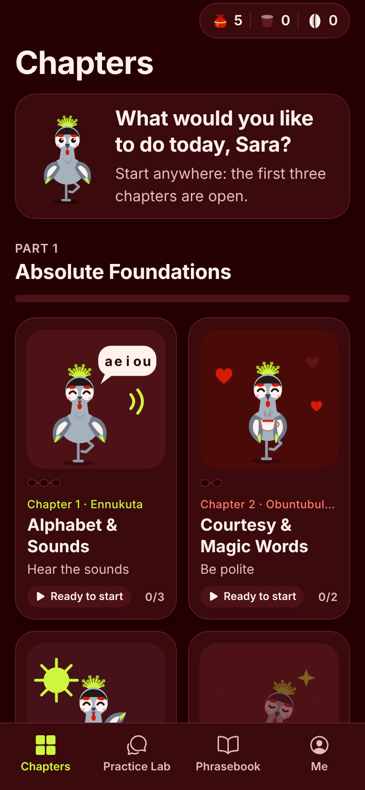
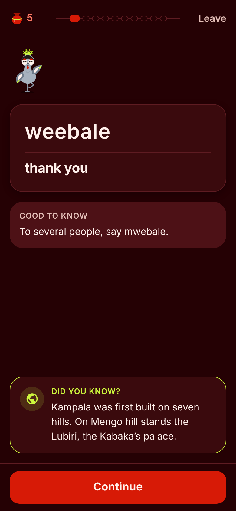

# Yiga Oluganda 🪶

**[English](#english) · [Svenska](#svenska)**

A mobile app for learning Luganda with **Ngaali**, the crested crane. It runs on iOS, Android and the web, built with Expo (React Native).
It is for absolute beginners, diaspora heritage learners, travellers and anyone curious about the language.

<p>




</p>
<p>


</p>

---

## English

### What's in the app

| PRD area | What was built |
|---|---|
| **Navigation** | Four tabs: **Chapters** (home grid), **Practice Lab**, **Phrasebook** (dictionary) and **Me**. Each tab has an iOS-style large title that folds into the top bar as you scroll, the same on iOS, Android and web |
| **Home** | One capsule with your water pots, drumbeat and cowries, then Ngaali greeting you by name with a tip. Below that, Part 1 as a 2-column grid of 12 square chapter cards. Each card has its own Ngaali illustration (bowing to an elder, riding a boda-boda, holding a plate of matooke, …), a string of beads with one bead per lesson, and a status: *Locked, Unlocked, Ready to start, Active, Unfinished* or *Completed* |
| **Non-linear unlocking** | Chapters 1–3 are open from the start, and each chapter you finish opens the next locked one, so you choose the order. The final conversation (chapter 12) opens after chapters 1–11 |
| **Curriculum** | Part 1, *Absolute Foundations*: the 12 chapters from the PRD, in 26 lessons. It has 93 phrases, 49 sentences, 12 roleplay conversations and 22 culture tips, all in English and Swedish |
| **Lesson engine** | Each lesson has about 10 steps built from the 7 PRD exercise types, plus a card that introduces each new phrase before it is tested. At the top: your water pots on the left, a string of beads (one per step) in the middle, and *Leave* on the right. After you check an answer, the result appears in the page right under it and *Check* turns into *Continue*. Wrong answers come back once at the end of the lesson |
| **Exercises** | **Sound & Vowel Matcher**: pick the right spelling. The wrong options differ only in sound length (*weebale / webale / weebbale*). **Join each word to its meaning**: joined pairs leave the columns and are threaded onto a list. **Build it in Luganda**: the words you tap are written on a line, like a sentence in an exercise book. **Listen, then build what you hear** (dictation). **Speak & compare**. **Roleplay chat**: a wrong reply gets an explanation from Ngaali. **Culture tip** cards |
| **Ngaali's states** | Ngaali stands on one leg like a resting crane, with a neon yellow crown. *Idle* (bobs and blinks), *correct* (hops with wings up), *incorrect* (encouraging pose) and *badge* (holds a medal). Ngaali greets you, introduces new phrases and celebrates at the end of a lesson, but stays out of the answer results |
| **Game layer** | Built from Buganda life (see *Our own symbols* below). Progress is counted in **phrases learned**, not points. **5 water pots**: a wrong answer in a lesson spills one. A pot refills every 20 minutes, and a quick review in the Practice Lab fetches water for all of them. **Cowries**: 5 per lesson, 5 more for no mistakes, 2 per practice round. The **drumbeat** counts the days in a row you practise. 12 **shields** to earn |
| **Practice Lab** | Spaced-repetition review, which fills your water pots. You can replay finished conversations. There is audio matching and Speak & compare. Practice never spills water |
| **Phrasebook** | Works offline. Search accepts *ng'* for ŋ and single letters for doubled ones. Phrases are grouped by everyday situation, and a **Roots & prefixes** guide covers *oku-*, *si-*, *n-/m-/ŋ-*, *tu-/mu-/ba-*, *w-/mw-* and *-ange* |
| **Me** | Phrases learned (out of the 93 in Part 1), drumbeat, cowries, this week (one drum per day), a chapter map with a bead string per chapter, your shields, and a **Practise with family** card |
| **Languages** | The interface is in English or Swedish. You choose it at the start and can change it in Settings |
| **Did you know?** | Each new-phrase screen ends with a fun fact about Uganda or Buganda (27 so far, in [`content/facts.json`](content/facts.json)). They are shown in order, so none repeats until you have seen them all |
| **Type** | The device's system font: San Francisco on iPhone, iPad and Mac (and in Safari), Roboto on Android. Nothing is bundled, and every weight covers Luganda's ŋ and Swedish å ä ö |
| **Colours** | Only three colours and their shades: deep maroon `#250104` for every background and card, tomato red `#D71A06` for buttons, water pots and wrong answers, and neon yellow `#CDF73D` for correct answers, progress beads, earned shields and the selected tab. Text is a soft off-white tinted from the palette |

### Our own symbols

The game layer is drawn from Buganda life, so it looks and feels like this app and no other.

| In the app | What it is | Where it comes from |
|---|---|---|
| **Water pots** | Your 5 lives. A wrong answer spills one; they refill over time, or you fetch water with a quick review | Drinking water is kept cool in a clay pot, *ensuwa* |
| **Cowries** | What you earn in lessons and practice. 30 fill all your pots | Cowrie shells were once money in Buganda |
| **Drumbeat** | Days in a row you practise | Drums announce great royal events; the Kabaka's royal drums are the *Mujaguzo* |
| **Beads** | Progress: one bead per step in a lesson, one per lesson on each chapter card | Ugandan rolled paper beads |
| **Shields** | Achievements, e.g. *Steady hand*, *Finding the beat*, *Royal drummer*, *Full basket* | The Kiganda shield, *engabo* |
| **Bulungi nnyo!** | The end of a lesson lists the phrases you just learned, not a score | "Very good!" in Luganda |
| **mpola** | The slow playback button | "Slowly" in Luganda |

The facts behind the pots, cowries, drums and beads are also in the *Did you know?* rotation.

### Where the app differs from the PRD, and why

- **Audio.** No native-speaker recordings exist yet, and the app never uses text-to-speech for Luganda because it mispronounces the language. Listening, dictation and the native-speaker comparison appear **automatically** once recordings are added (see *Adding audio*). Until then, the Sound & Vowel Matcher shows the meaning instead of playing a sound.
- **Audio format.** The PRD asks for Opus. The app uses **AAC in .m4a**, because iOS cannot reliably play Opus or Ogg. The preparation script can also write Opus files. Slow playback (the **mpola** button, Luganda for "slowly") is the same clip played at 0.75× with pitch correction, so no separate slow recordings are needed. Clips are pre-loaded before each lesson starts.
- **Speech & pitch verification.** You record yourself and play your voice next to the native clip, then judge how close it was. There is no automatic scoring, because no reliable Luganda pronunciation model exists to run on a phone. The app says this on screen.
- **Friend leaderboards** are replaced by a **Practise with family** card. A leaderboard needs accounts and a server, and the best practice partner for most learners is a Luganda speaker they already know.
- **Unit downloads from a CDN.** Only Part 1 exists, and it is bundled so it works offline.
- **What cowries buy.** The PRD doesn't say, so 30 cowries fill all your water pots.
- **Content changes.** These were flagged for a native speaker in [`content/CONTENT_REPORT.md`](content/CONTENT_REPORT.md):
  - *Ki kano?* was taught as *Ki kati?*
  - *Mwe* was taught as *mmwe*.
  - *Yeye* was taught as *ye* (and *yeye* is accepted).
- **Mascot name.** The PRD uses both "Kigo" and "Ngaali". The app uses **Ngaali** throughout.

### Run it

You need [Node.js](https://nodejs.org) 20 or newer.

```bash
npm install
```

```bash
npx expo start
```

Scan the QR code with **Expo Go** on your phone, or press `w` to open it in a browser.

| Command | What it does |
|---|---|
| `npm test` | Unit tests: lesson engine, rules, content checks, colour contrast, translations |
| `npm run typecheck` | TypeScript check |
| `npm run lint` | ESLint (Expo's config) |
| `npm run doctor` | Checks Expo dependencies and config |
| `npm run audio` | Rebuilds the list of recordings and `AUDIO_TODO.md` |
| `npm run report` | Rebuilds `content/CONTENT_REPORT.md` |
| `npm run icons` / `npm run sfx` | Regenerate the app icons and sound effects |

End-to-end test in a real browser (mobile and desktop sizes):

```bash
EXPO_PUBLIC_E2E=1 npm run export:web && npm run e2e
```

### Build for the App Store and Google Play

Builds run in the cloud with EAS, so you don't need Xcode or Android Studio. You do need an Expo account, plus an Apple Developer and/or Google Play account.

```bash
npx eas-cli@latest build --platform all
```

### The web app (app.yigaoluganda.com)

The web version runs on its **own Netlify site, `yigaoluganda-app`**, separate from the landing page site that serves yigaoluganda.com. A broken app deploy can't affect the landing page, and the other way round.

- [`netlify.toml`](netlify.toml) builds with `npm run export:web` and publishes `dist/` as a single-page app, with long caching for the hashed bundles and security headers. The microphone is allowed for Speak & compare.
- Production is public. Preview deploys need a Netlify team login.
- Build it locally with `npm run export:web`. The output is a static site in `dist/`.

### Editing content

All content is plain JSON in [`content/unit-1/`](content/unit-1). `npm test` tells you exactly what's wrong if an id is missing or a translation is empty.

- `phrases.json`: each phrase has an `id` (also its audio file name), `lg` (Luganda), `tr` (`en` and `sv`), and optional `literal`, `note`, `variants` and `check` (a note for a native speaker).
- `sentences.json`: sentences for the word bank and dictation. `{name}` becomes the learner's name.
- `chapters.json`: chapters and their lessons. Each lesson lists its new `phrases`, plus `review`, `sentences`, `sounds`, `tip` and `dialogue`.
- `dialogues.json`: roleplay conversations. Each `choose` line needs exactly one `correct` option, and every wrong option needs a `why`.
- `tips.json`, `sound-pairs.json`, `roots.json`: culture tips, long/short sound pairs and the roots guide.
- [`content/facts.json`](content/facts.json): the "Did you know?" fun facts about Uganda and Buganda, each in English and Swedish.

The app builds each lesson's exercises from these files automatically.

### Adding audio

1. Record each phrase with a native speaker and name the file after its id, e.g. `weebale.wav` or `s-kale-weebale.wav`. [`AUDIO_TODO.md`](AUDIO_TODO.md) lists every id that still needs a recording.
2. Run this to trim silence, normalise to −16 LUFS and save mono AAC clips into `assets/audio/` (needs `ffmpeg`):

   ```bash
   npm run audio:prepare -- path/to/recordings
   ```

3. Restart the app. Speaker buttons, listening, dictation and native comparison appear for every recorded item.

### Project layout

```
content/unit-1/     course content (JSON) + CONTENT_REPORT.md
assets/audio/       native-speaker clips (<id>.m4a)
src/app/            screens (Expo Router): tabs, chapter, lesson, practice, phrase, settings, onboarding
src/lesson/         lesson player, result card, the exercise components
src/logic/          pure, unit-tested rules: generator, spelling distractors, water pots/cowries/drumbeat, unlocking, SRS, shields
src/state/          Zustand store, saved on the device (AsyncStorage)
src/ui/             Ngaali, chapter illustrations, bead strings, pot/drum/cowrie icons, design tokens (colours, type in theme.ts)
src/i18n/           English and Swedish interface text
scripts/            audio, icons, sound effects, content report, e2e
```

### Privacy

There are no accounts, ads, analytics or tracking. Progress and recordings stay on the device. You can erase everything in *Profile → Settings → Reset progress*.

The previous web version of the app, based on the book *Luganda för beginners* by Cyprine Kamoga, is in the git history at commit `6a7fad7`.

---

## Svenska

**Yiga Oluganda** är en app för att lära sig luganda tillsammans med kronstranen **Ngaali**. Den fungerar på iOS, Android och webben och är byggd med Expo (React Native). Gränssnittet finns på svenska och engelska.

**I appen:**
- En startsida med rutnät över del 1:s 12 kapitel, med ett pärlband per kapitel. Kapitlen öppnas i den ordning du själv väljer.
- Lektioner med cirka 10 steg av 7 övningstyper: ljud- och vokalmatchning, para ihop, bygga meningar, diktamen, prata och jämföra, rollspel och kulturtips.
- Ett eget spelsystem från Buganda: vattenkrukor (ett fel spiller en kruka), kaurisnäckor, trumslag för dagar i rad och sköldar. Framsteg räknas i fraser du kan, inte poäng.
- Ett övningslabb med repetition som fyller vattenkrukorna.
- En parlör som fungerar offline och har en guide till ordstammar och prefix.
- ”Visste du?”: en rolig fakta om Uganda eller Buganda på varje sida med en ny fras (`content/facts.json`).

**Starta appen** (Node.js 20 eller senare):

```bash
npm install
```

```bash
npx expo start
```

Skanna QR-koden med **Expo Go** eller tryck `w` för webbläsaren.

**Innehåll:** allt ligger som JSON i `content/unit-1/`. Kör `npm test` efter ändringar.

**Ljud:** spela in med en modersmålstalare, döp filerna efter id (se `AUDIO_TODO.md`) och kör:

```bash
npm run audio:prepare -- mapp/med/inspelningar
```

Appen använder aldrig datorröst för luganda.

**Viktigt:** lugandan i del 1 har inte granskats av en modersmålstalare än. Det som är mest osäkert listas i [`content/CONTENT_REPORT.md`](content/CONTENT_REPORT.md).

**Integritet:** inga konton, ingen reklam och ingen spårning. Allt sparas på enheten.
