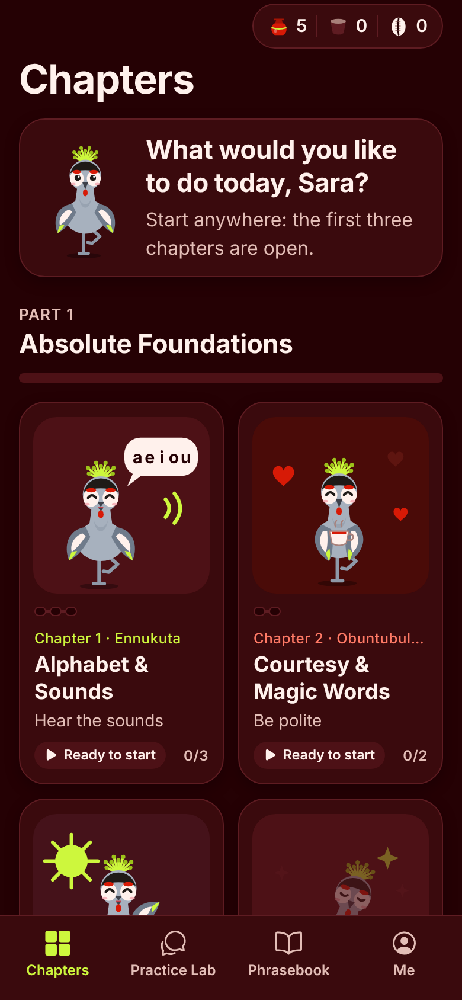
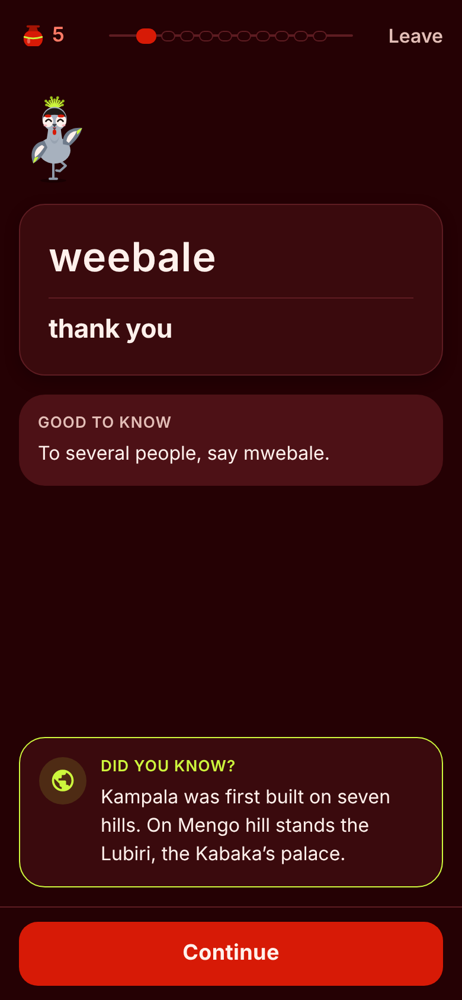
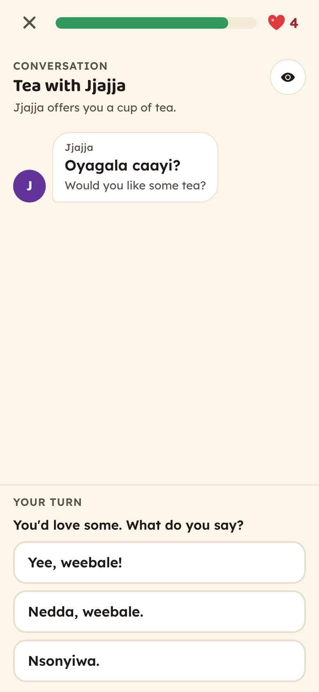
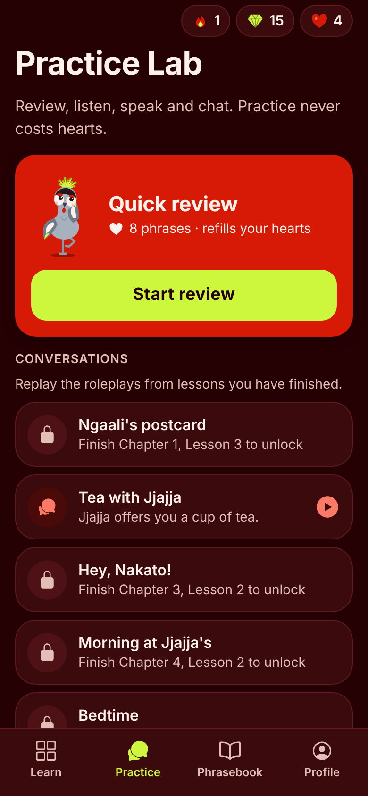
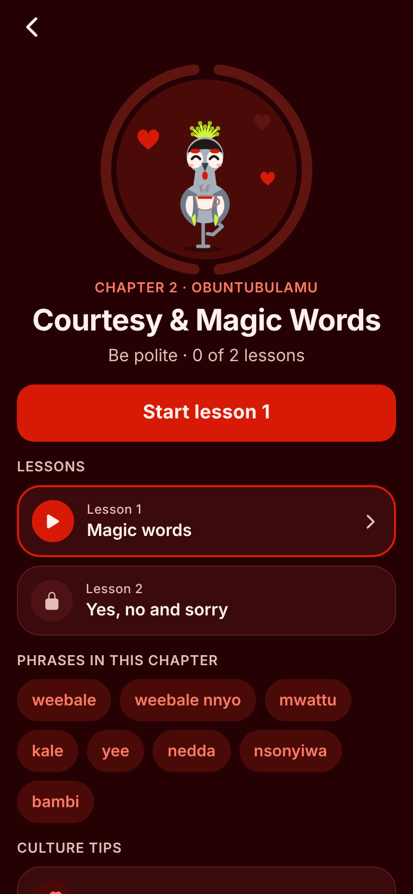
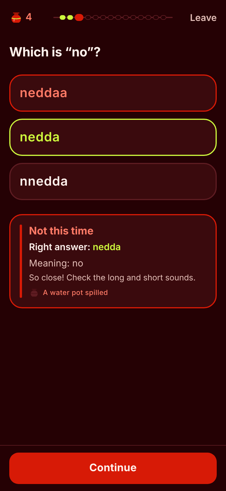
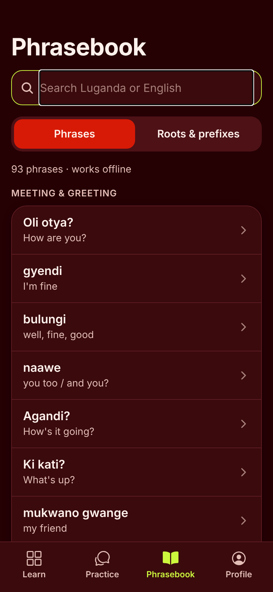
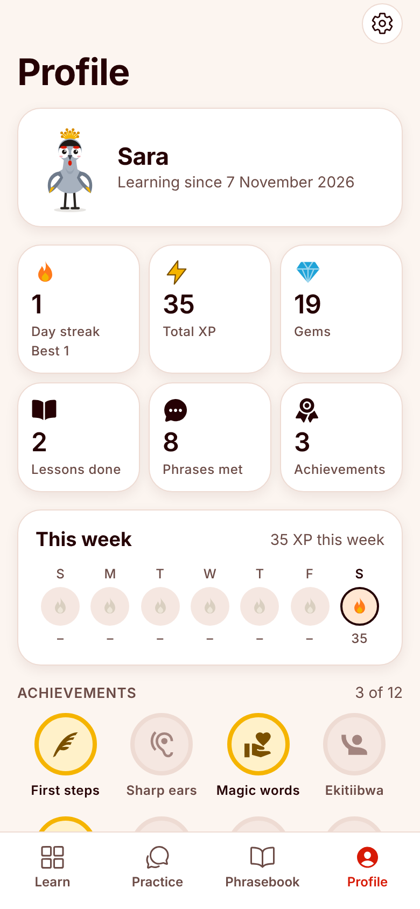

# Yiga Oluganda 🪶

**[English](#english) · [Svenska](#svenska)**

A mobile app for learning Luganda with **Ngaali**, the crested crane. It runs on iOS, Android and the web, built with Expo (React Native).
It is for absolute beginners, diaspora heritage learners, travellers and anyone curious about the language.

<p>




</p>
<p>




</p>

---

## English

### What's in the app

| PRD area | What was built |
|---|---|
| **Navigation** | Four tabs: **Chapters** (home grid), **Practice Lab**, **Phrasebook** (dictionary) and **Me**. Each tab has an iOS-style large title that folds into the top bar as you scroll, the same on iOS, Android and web |
| **Home** | One capsule with your water pots, drumbeat and cowries, then Ngaali greeting you by name with a tip. Below that, Part 1 and Part 2 as 2-column grids of square chapter cards. Each card has its own Ngaali illustration (bowing to an elder, riding a boda-boda, holding a plate of matooke, …), a string of beads with one bead per lesson, and a status: *Locked, Unlocked, Ready to start, Active, Unfinished* or *Completed* |
| **Non-linear unlocking** | In each part, the first three chapters are open, and each chapter you finish opens the next locked one, so you choose the order. A part's final conversation opens when its other chapters are done, and finishing it opens the next part |
| **Curriculum** | Ordered by what you need first: greetings, introducing yourself and the everyday words come first, grammar and the sound system later. **Part 1, *Absolute Foundations*** (13 chapters, 29 lessons, 108 phrases, 62 sentences, 12 roleplay conversations, 25 culture tips): Informal Greetings, Introductions & Names, Everyday Words, Courtesy & Magic Words, Survival Expressions, Respect & Formal Titles, Goodbyes & Well Wishes, Question Words, Alphabet & Sounds, Personal Pronouns, To Be, Daily Thanks & Appreciation, Final Conversation. **Part 2, *Everyday Life*** (9 chapters, 18 lessons, 66 phrases, 45 sentences, 9 conversations, 12 tips): Family, Numbers 1–10, Food & Drink, Money & the Market, Time & Days, Getting Around, Visiting a Home, Body & Health, Final Conversation. Chapter ids (c01–c22) stay the same when the order changes, so learners keep their progress. Everything is in English and Swedish |
| **Placement test** | *Already know some Luganda?* One question per chapter, with a second chance on a miss; the test stops at the first chapter missed twice. Known chapters are marked done (a part's final conversation too, when all its chapters are known), so heritage learners skip ahead. Offered on the home screen to new learners, and always in the Practice Lab |
| **Daily reminders** | Off by default. After the first lesson Ngaali offers a daily nudge; Settings has the switch and the hour (07, 12, 18 or 21). On phones it is a local notification, skipped on days you've already practised. On the web it is an e-mail, sent by the hourly `reminders` function (Supabase cron + Resend) to subscribers who haven't practised that day, with a one-click unsubscribe link |
| **Lesson engine** | Each lesson has about 10 steps built from the 7 PRD exercise types, plus a card that introduces each new phrase before it is tested. At the top: your water pots on the left, a string of beads (one per step) in the middle, and *Leave* on the right. After you check an answer, the result appears in the page right under it and *Check* turns into *Continue*. Wrong answers come back once at the end of the lesson |
| **Exercises** | **Sound & Vowel Matcher**: pick the right spelling. The wrong options differ only in sound length (*weebale / webale / weebbale*). **Join each word to its meaning**: joined pairs leave the columns and are threaded onto a list. **Build it in Luganda**: the words you tap are written on a line, like a sentence in an exercise book. **Listen, then build what you hear** (dictation). **Speak & compare**. **Roleplay chat**: a wrong reply gets an explanation from Ngaali. **Culture tip** cards |
| **Ngaali's states** | Ngaali stands on one leg like a resting crane, with a neon yellow crown. *Idle* (bobs and blinks), *correct* (hops with wings up), *incorrect* (encouraging pose) and *badge* (holds a medal). Ngaali greets you, introduces new phrases and celebrates at the end of a lesson, but stays out of the answer results |
| **Game layer** | Built from Buganda life (see *Our own symbols* below). Progress is counted in **phrases learned**, not points. **5 water pots**: a wrong answer in a lesson spills one. A pot refills every 20 minutes, and a quick review in the Practice Lab fetches water for all of them. **Cowries**: 5 per lesson, 5 more for no mistakes, 2 per practice round. The **drumbeat** counts the days in a row you practise. 12 **shields** to earn |
| **Practice Lab** | Spaced-repetition review, which fills your water pots. You can replay finished conversations. There is audio matching and Speak & compare. Practice never spills water |
| **Phrasebook** | Works offline. Search accepts *ng'* for ŋ and single letters for doubled ones. Phrases are grouped by everyday situation, and a **Roots & prefixes** guide covers *oku-*, *si-*, *n-/m-/ŋ-*, *tu-/mu-/ba-*, *w-/mw-* and *-ange* |
| **Me** | Phrases learned (out of every phrase in the course), drumbeat, cowries, this week (one drum per day), a chapter map with a bead string per chapter, your shields, and a **Practise with family** card |
| **Kids mode** | *Who's learning?* (on the Me tab): a parent adds up to four children, each with their own progress, kept in the account (`child_profiles`). In a child's profile there are no water pots to lose, no settings, payments or account actions, and leaving it, or adding and changing profiles, takes a grown-up check (a times-table question written in words) |
| **Certificates** | Finishing every chapter of a part, with its final conversation played (not skipped by the placement test), earns a certificate. The learner writes the name to print; the `issue_certificate` function checks the subscription and gives a code like `YO-ABCD-EFGH-JK23`. The certificate saves as an A4 PDF (the browser's print window on the web, `expo-print` + `expo-sharing` on phones) and its link opens [yigaoluganda.com/verify](https://yigaoluganda.com/verify/), where anyone can check the code (`verify_certificate` shows only the name, part, phrase count and date). Children get their own. Listed on the Me tab; the end of a part's last lesson offers it |
| **Native-speaker feedback** | After recording in Speak & compare, *Ask a native speaker* uploads the recording (private bucket `recordings`, the learner's own folder) and puts it on the review list (`request_feedback`, at most 5 waiting). A reviewer rates it (*Sounds right / Almost there / Try again*) with an optional tip; the answer shows on the Me tab under *Feedback from native speakers*. Recordings are deleted after 30 days |
| **Report a mistake** | A flag in the lesson's top bar (it reports the step on screen) and a link on each phrase's page. The learner picks what is wrong and can add a note; each report is e-mailed to the support address (`review-mail`) |
| **Reviewing** | `/review` (Settings → *Review recordings and reports*, also linked from the daily e-mail) is open to the owner and the reviewers the owner adds by e-mail (`reviewers` table). Three tabs: recordings to rate, reports to close as *Fixed* or *Not a mistake*, and (owner) who may review. None of this shows in a child's profile |
| **Typing answers** | *Write it in Luganda*: the meaning is shown and the learner types the phrase. Capitals, punctuation and how ŋ is typed (a ŋ key, or ng') don't matter; sound length always does. One slipped letter in a longer answer is forgiven and the spelling shown. Each lesson writes one new phrase and a known review phrase; reviews write the rest |
| **Daily goal** | 1, 2 or 3 lessons or practice rounds a day (Settings, or tap the goal on the home screen). Home shows today's beads; the round that reaches the goal says so |
| **Reading stories** | Seven short text-only stories in the Practice Lab ([`content/stories.json`](content/stories.json)), built from course sentences, each opening after its chapter. Tap a line for its meaning; questions at the end; counts towards the daily goal |
| **Refer a friend** | Paying learners get a personal code and a link (yigaoluganda.com/?ref=CODE). The friend's first month is free (first-time customers only); when the friend pays for a month after that, the inviter's next month is free, one at a time (`referral-code`, `_shared/referrals.ts`, `invoice.paid` in the webhook) |
| **Schools** | Class licences. Schools ask at yigaoluganda.com/schools (or /sv/skolor). The owner creates a class for a teacher (Review → Schools: seats and an end date) and gets an 8-character code; students sign up with the teacher's link (`/sign-up?class=CODE`) or type the code on the plan page and learn without paying until the licence ends. Teachers see each student's progress under Me → Your classes |
| **E-mails** | Daily reminders (opt-in), and *Tips by e-mail* (on by default, off in Settings or with the link in each): welcome e-mails on day 1, 3 and 7 and one after a subscription ends (`lifecycle-mail`, hourly, at most one a day, only for accounts created after it was switched on) |
| **Owner tools** | Settings → *Dashboard*: accounts, sign-ups, paying learners, revenue before VAT, cancellations, the most reported items (`owner_stats`). Review → Schools for class licences |
| **Your data** | Settings: download everything the account holds (JSON), change the e-mail address (with a confirmation link), delete the account |
| **Languages** | The interface is in English or Swedish. You choose it at the start and can change it in Settings |
| **Did you know?** | Each new-phrase screen ends with a fun fact about Uganda or Buganda (27 so far, in [`content/facts.json`](content/facts.json)). They are shown in order, so none repeats until you have seen them all |
| **Type** | The device's system font: San Francisco on iPhone, iPad and Mac (and in Safari), Roboto on Android. Nothing is bundled, and every weight covers Luganda's ŋ and Swedish å ä ö |
| **Colours** | Only three colours and their shades: deep maroon `#250104` for every background and card, tomato red `#D71A06` for buttons, water pots and wrong answers, and neon yellow `#CDF73D` for correct answers, progress beads, earned shields and the selected tab. Text is a soft off-white tinted from the palette |

### Our own symbols

The game layer is drawn from Buganda life, so it looks and feels like this app and no other.

| In the app | What it is | Where it comes from |
|---|---|---|
| **Water pots** | Your 5 lives. A wrong answer spills one; they refill over time, or you fetch water with a quick review | Drinking water is kept cool in a clay pot, *ensuwa* |
| **Cowries** | What you earn in lessons and practice. 30 fill all your pots | Cowrie shells were once money in Buganda |
| **Drumbeat** | Days in a row you practise | Drums announce great royal events; the Kabaka's royal drums are the *Mujaguzo* |
| **Beads** | Progress: one bead per step in a lesson, one per lesson on each chapter card | Ugandan rolled paper beads |
| **Shields** | Achievements, e.g. *Steady hand*, *Finding the beat*, *Royal drummer*, *Full basket* | The Kiganda shield, *engabo* |
| **Bulungi nnyo!** | The end of a lesson lists the phrases you just learned, not a score | "Very good!" in Luganda |
| **mpola** | The slow playback button | "Slowly" in Luganda |

The facts behind the pots, cowries, drums and beads are also in the *Did you know?* rotation.

### Where the app differs from the PRD, and why

- **Audio.** No native-speaker recordings exist yet, and the app never uses text-to-speech for Luganda because it mispronounces the language. Listening, dictation and the native-speaker comparison appear **automatically** once recordings are added (see *Adding audio*). Until then, the Sound & Vowel Matcher shows the meaning instead of playing a sound.
- **Audio format.** The PRD asks for Opus. The app uses **AAC in .m4a**, because iOS cannot reliably play Opus or Ogg. The preparation script can also write Opus files. Slow playback (the **mpola** button, Luganda for "slowly") is the same clip played at 0.75× with pitch correction, so no separate slow recordings are needed. Clips are pre-loaded before each lesson starts.
- **Speech & pitch verification.** You record yourself and play your voice next to the native clip, then judge how close it was. There is no automatic scoring, because no reliable Luganda pronunciation model exists to run on a phone. The app says this on screen.
- **Friend leaderboards** are replaced by a **Practise with family** card. A leaderboard needs accounts and a server, and the best practice partner for most learners is a Luganda speaker they already know.
- **Unit downloads from a CDN.** Only Part 1 exists, and it is bundled so it works offline.
- **What cowries buy.** The PRD doesn't say, so 30 cowries fill all your water pots.
- **Content changes.** These were flagged for a native speaker in [`content/CONTENT_REPORT.md`](content/CONTENT_REPORT.md):
  - *Ki kano?* was taught as *Ki kati?*
  - *Mwe* was taught as *mmwe*.
  - *Yeye* was taught as *ye* (and *yeye* is accepted).
- **Mascot name.** The PRD uses both "Kigo" and "Ngaali". The app uses **Ngaali** throughout.

### Landing page, accounts and payments

The project is three parts that are deployed separately:

| Part | Where | Folder |
|---|---|---|
| **Landing page** | yigaoluganda.com | [`landing/`](landing) (static site, English at `/`, Swedish at `/sv/`, terms and privacy pages) |
| **The app** | app.yigaoluganda.com | this folder (Expo web build) |
| **Backend** | Supabase (EU) | [`supabase/`](supabase) (database tables and the payment functions) |

- **Price.** One monthly plan: €3.99 + VAT, shown in each visitor's local currency (16 currencies, e.g. 55,00 kr incl. moms in Sweden, £3.49 in the UK). The table is [`src/pricing/pricing.ts`](src/pricing/pricing.ts). Stripe Tax adds 25% Swedish VAT for every EU customer (Swedish registration under the EU small-seller rule, below EUR 10,000 a year of sales to other EU countries), so EU visitors see the price including VAT, e.g. €4.99 in Germany. Visitors from other countries see the net price. There is no free trial.
- **Accounts.** Sign up with name, e-mail and password. The password field has an eye button to show or hide what you typed. Log in, forgot password, a new password from the e-mail link, log out and delete account. Progress is saved to the account and follows the learner between devices.
- **Paying.** Only on the website, through Stripe Checkout. The plan screen says why: it's cheaper than an app store and keeps the app affordable. The phone apps never sell anything. After paying, the course unlocks. Settings shows the subscription, *Manage subscription* (Stripe's portal: cancel, change card, receipts) and, for 14 days, *Withdraw from contract* (ends it; refunds in full the first time, after that the unused part of the period).
- **Without Supabase settings** (`EXPO_PUBLIC_SUPABASE_URL` / `EXPO_PUBLIC_SUPABASE_PUBLISHABLE_KEY`), the app runs as before, with no accounts and progress on the device only. Development and the offline e2e test use this mode.

| Command | What it does |
|---|---|
| `npm run sites:sync` | Copies the price table and course facts to the landing page and the app's edge function |
| `cd landing && node build.mjs` | Builds the landing page into `landing/dist/` (the landing site deploys from the `landing/` folder) |
| `npm run stripe:setup` | Creates the Stripe price (all currencies), customer portal and webhook (see the script) |
| `npm run e2e:accounts` | Browser test of sign-up, password show/hide, paying, withdrawing and log-in, with Supabase and Stripe mocked |
| `npm run e2e:landing` | Browser test of the landing site with its security policy: invite links, the certificate check and the For schools form |

**Going live** (done for yigaoluganda.com in November 2026; live payments tested with a real payment and refund):
1. Fill in the company details in [`landing/src/company.mjs`](landing/src/company.mjs), and have the terms and privacy policy ([`landing/src/legal.mjs`](landing/src/legal.mjs)) checked.
2. Create the Supabase project (EU). Apply [`supabase/migrations`](supabase/migrations) and deploy the six functions in [`supabase/functions`](supabase/functions).
3. In Stripe, set the terms URL under *Public details*. Run `npm run stripe:setup -- --webhook https://<ref>.supabase.co` with a test key, then with the live key. The script turns on Stripe Tax with a Swedish registration under the small-seller scheme, so every EU customer pays Swedish VAT (25%); see `TAX_COLLECTED` in [`src/pricing/pricing.ts`](src/pricing/pricing.ts) if the company later moves to the EU One-Stop Shop.
4. Save the Edge Function secrets `STRIPE_SECRET_KEY` and `STRIPE_WEBHOOK_SECRET` (the functions find the price and the portal by name). For reminder e-mails, also save `RESEND_API_KEY` (the sending domain yigaoluganda.com must be verified in Resend).
5. Put the Supabase URL and publishable key in [`netlify.toml`](netlify.toml). In Supabase, set *Authentication → URL Configuration* to the app's address, and add your own SMTP (e.g. Resend) so sign-up e-mails reach everyone.
6. Point yigaoluganda.com at the landing site and app.yigaoluganda.com at the app site.

**Sign in with Google (web):** the sign-up and log-in screens show Google's own button when the
build has `EXPO_PUBLIC_GOOGLE_CLIENT_ID`. Google hands the page an ID token and Supabase checks it
(`signInWithIdToken`), so Google's window shows app.yigaoluganda.com. To set it up: in Google Cloud,
create an OAuth client of type *Web application* with `https://app.yigaoluganda.com` under
*Authorized JavaScript origins*; in Supabase → Authentication → Sign In / Providers → Google, switch
it on with that client id and secret; put the client id in [`netlify.toml`](netlify.toml). New
Google accounts get the first name (see `handle_new_user`), keep the language chosen on the page and
go straight to payment.

**Free first month for chosen people:** the payment page accepts promotion codes. The Stripe coupon
`yiga-first-month-free` takes 100% off the first month; then the normal price applies until the
customer cancels. The code `GYEBALEKO` (20 uses, new customers only, until February 2027) uses it.
To make more codes (for example one per person): Stripe → Product catalog → Coupons →
*First month free* → Add promotion code.

### Run it

You need [Node.js](https://nodejs.org) 20 or newer.

```bash
npm install
```

```bash
npx expo start
```

Scan the QR code with **Expo Go** on your phone, or press `w` to open it in a browser.

| Command | What it does |
|---|---|
| `npm test` | Unit tests: lesson engine, rules, content checks, colour contrast, translations, prices, subscription rules |
| `npm run typecheck` | TypeScript check |
| `npm run lint` | ESLint (Expo's config) |
| `npm run doctor` | Checks Expo dependencies and config |
| `npm run audio` | Rebuilds the list of recordings and `AUDIO_TODO.md` |
| `npm run report` | Rebuilds `content/CONTENT_REPORT.md` |
| `npm run icons` / `npm run sfx` | Regenerate the app icons and sound effects |

End-to-end test in a real browser (mobile and desktop sizes):

```bash
EXPO_PUBLIC_E2E=1 EXPO_PUBLIC_KIDS=1 npm run export:web && npm run e2e
```

### Build for the App Store and Google Play

Builds run in the cloud with EAS, so you don't need Xcode or Android Studio. You do need an Expo account, plus an Apple Developer and/or Google Play account.

```bash
npx eas-cli@latest build --platform all
```

### The web app (app.yigaoluganda.com)

The web version runs on its **own Netlify site, `yigaoluganda-app`**, separate from the landing page site that serves yigaoluganda.com. A broken app deploy can't affect the landing page, and the other way round.

- [`netlify.toml`](netlify.toml) builds with `npm run export:web` and publishes `dist/` as a single-page app, with long caching for the hashed bundles and security headers. The microphone is allowed for Speak & compare.
- Production is public. Preview deploys need a Netlify team login.
- Build it locally with `npm run export:web`. The output is a static site in `dist/`.

### Editing content

All content is plain JSON in [`content/unit-1/`](content/unit-1). `npm test` tells you exactly what's wrong if an id is missing or a translation is empty.

- `phrases.json`: each phrase has an `id` (also its audio file name), `lg` (Luganda), `tr` (`en` and `sv`), and optional `literal`, `note`, `variants` and `check` (a note for a native speaker).
- `sentences.json`: sentences for the word bank and dictation. `{name}` becomes the learner's name.
- `chapters.json`: chapters and their lessons. Each lesson lists its new `phrases`, plus `review`, `sentences`, `sounds`, `tip` and `dialogue`.
- `dialogues.json`: roleplay conversations. Each `choose` line needs exactly one `correct` option, and every wrong option needs a `why`.
- `tips.json`, `sound-pairs.json`, `roots.json`: culture tips, long/short sound pairs and the roots guide.
- [`content/facts.json`](content/facts.json): the "Did you know?" fun facts about Uganda and Buganda, each in English and Swedish.

The app builds each lesson's exercises from these files automatically.

### Adding audio

1. Record each phrase with a native speaker and name the file after its id, e.g. `weebale.wav` or `s-kale-weebale.wav`. [`AUDIO_TODO.md`](AUDIO_TODO.md) lists every id that still needs a recording.
2. Run this to trim silence, normalise to −16 LUFS and save mono AAC clips into `assets/audio/` (needs `ffmpeg`):

   ```bash
   npm run audio:prepare -- path/to/recordings
   ```

3. Restart the app. Speaker buttons, listening, dictation and native comparison appear for every recorded item.

### Project layout

```
content/unit-1/     course content (JSON) + CONTENT_REPORT.md
assets/audio/       native-speaker clips (<id>.m4a)
src/app/            screens (Expo Router): tabs, chapter, lesson, practice, phrase, settings, onboarding
src/lesson/         lesson player, result card, the exercise components
src/logic/          pure, unit-tested rules: generator, spelling distractors, water pots/cowries/drumbeat, unlocking, SRS, shields
src/state/          Zustand store, saved on the device (AsyncStorage) and, with an account, in Supabase
src/account/        accounts, subscription state, progress sync, local price
src/pricing/        the price table (local currencies, VAT)
landing/            the landing page (yigaoluganda.com)
supabase/           database migration and payment functions (Stripe)
src/ui/             Ngaali, chapter illustrations, bead strings, pot/drum/cowrie icons, design tokens (colours, type in theme.ts)
src/i18n/           English and Swedish interface text
scripts/            audio, icons, sound effects, content report, e2e
```

### Security

- **Both sites send a strict Content-Security-Policy** (see [`netlify.toml`](netlify.toml) and [`landing/netlify.toml`](landing/netlify.toml)): scripts only from the site itself, Google Sign-In and Cloudflare's bot test. The pages carry no inline scripts; the landing pages keep their data in `<script type="application/json">` blocks and run `landing/assets/js/*.js`. The browser tests serve each site with its policy and fail if the policy blocks anything, so change the policy and the code together.
- **The database decides who may do what** (row-level security, functions that check the caller). The publishable key in the sites is public by design; anonymous visitors can only check a certificate code.
- **Limits:** reports (20 a day), recordings waiting for review (20), sizes of saved progress and names, and the For schools form (3 an hour and 10 a day per visitor, by a hashed IP address).
- **Bot test (optional):** create a Cloudflare Turnstile widget for yigaoluganda.com and app.yigaoluganda.com. Put the site key in the app's build as `EXPO_PUBLIC_TURNSTILE_SITE_KEY` and in the landing build as `TURNSTILE_SITE_KEY` (both in Netlify), turn on *Authentication → Attack Protection → CAPTCHA* (Turnstile) in Supabase with the secret, and save the same secret as the `TURNSTILE_SECRET` function secret. Without a key, the forms work without a bot test. Supabase's setting covers every app, and only the web app shows the widget: the phone apps (when they are published) need one too before the setting is turned on, or their password log-in stops working.
- **Deleting an account** asks for the password again (or a fresh Google login), checked by the function, not only by the app.
- **Free months and refunds:** a free first month goes to a card only once (Stripe's card fingerprint), and the full refund on withdrawal applies to the first withdrawal; later withdrawals refund the unused part.
- **Report a problem** to hello@yigaoluganda.com.

### Privacy

There are no ads, analytics or tracking. With accounts on, the name, e-mail, progress and subscription status are stored in Supabase in the EU. Stripe handles payments, and card details never reach the app. Voice recordings stay on the device unless the learner sends one for native-speaker feedback; it is then stored privately (bucket `recordings`) and deleted after 30 days. A certificate's name, part, phrase count and date can be seen by anyone with its code. Learners can delete their account in the app.

The previous web version of the app, based on the book *Luganda för beginners* by Cyprine Kamoga, is in the git history at commit `6a7fad7`.

---

## Svenska

**Yiga Oluganda** är en app för att lära sig luganda tillsammans med kronstranen **Ngaali**. Den fungerar på iOS, Android och webben och är byggd med Expo (React Native). Gränssnittet finns på svenska och engelska.

**I appen:**
- En startsida med två delar: del 1 (12 kapitel) och del 2, Vardagen (9 kapitel om familj, siffror, marknaden, mat, tid, vägbeskrivningar, besök och hälsa), med ett pärlband per kapitel. Kapitlen öppnas i den ordning du själv väljer.
- Ett nivåtest (”Kan du redan lite luganda?”) som låter dig hoppa över kapitlen du redan kan.
- En daglig påminnelse om du vill: en notis i mobilen, ett mejl på webben.
- Barnläge: upp till fyra barnprofiler med egna framsteg, utan vattenkrukor, och en vuxenkontroll för att lämna profilen.
- Skriv svaret själv på luganda, ett dagligt mål (1–3 lektioner) och sju korta läsberättelser.
- Bjud in en vän (första månaden gratis för vännen, en gratis månad för dig) och klasslicenser för skolor (yigaoluganda.com/sv/skolor).
- Välkomstmejl de första dagarna (går att stänga av), en översikt för ägaren, och i inställningarna: ladda ner dina uppgifter och byt e-postadress.
- Fråga en modersmålstalare: skicka en inspelning från Prata och jämför och få ett omdöme och ett tips.
- Rapportera ett fel: en flagga i lektionen och en länk på varje fras. Granskare (ägaren och de som ägaren lägger till) svarar och stänger rapporter på `/review`.
- Diplom när en del är klar, med en kod som vem som helst kan kontrollera på yigaoluganda.com/sv/verify/, och som PDF att skriva ut.
- Lektioner med cirka 10 steg av 7 övningstyper: ljud- och vokalmatchning, para ihop, bygga meningar, diktamen, prata och jämföra, rollspel och kulturtips.
- Ett eget spelsystem från Buganda: vattenkrukor (ett fel spiller en kruka), kaurisnäckor, trumslag för dagar i rad och sköldar. Framsteg räknas i fraser du kan, inte poäng.
- Ett övningslabb med repetition som fyller vattenkrukorna.
- En parlör som fungerar offline och har en guide till ordstammar och prefix.
- ”Visste du?”: en rolig fakta om Uganda eller Buganda på varje sida med en ny fras (`content/facts.json`).

**Starta appen** (Node.js 20 eller senare):

```bash
npm install
```

```bash
npx expo start
```

Skanna QR-koden med **Expo Go** eller tryck `w` för webbläsaren.

**Innehåll:** allt ligger som JSON i `content/unit-1/`. Kör `npm test` efter ändringar.

**Ljud:** spela in med en modersmålstalare, döp filerna efter id (se `AUDIO_TODO.md`) och kör:

```bash
npm run audio:prepare -- mapp/med/inspelningar
```

Appen använder aldrig datorröst för luganda.

**Viktigt:** lugandan i del 1 har inte granskats av en modersmålstalare än. Det som är mest osäkert listas i [`content/CONTENT_REPORT.md`](content/CONTENT_REPORT.md).

**Webbplats och betalning:** landningssidan ligger i `landing/` (yigaoluganda.com). Appen kräver ett konto och ett abonnemang: 3,99 € + moms i månaden, i besökarens egen valuta, utan gratisperiod. Betalningen sker bara på webben, via Stripe. Lösenordsfältet har en ögonknapp för att visa eller dölja lösenordet.

**Integritet:** ingen reklam och ingen spårning. Konto och framsteg sparas inom EU (Supabase), och betalningar sköts av Stripe.

**Säkerhet:** båda webbplatserna har en strikt Content-Security-Policy, databasen kontrollerar varje behörighet, och formulär och rapporter har gränser. Ett robottest (Cloudflare Turnstile) kan slås på; se avsnittet *Security* på engelska. Hittar du ett säkerhetsproblem, mejla hello@yigaoluganda.com.
