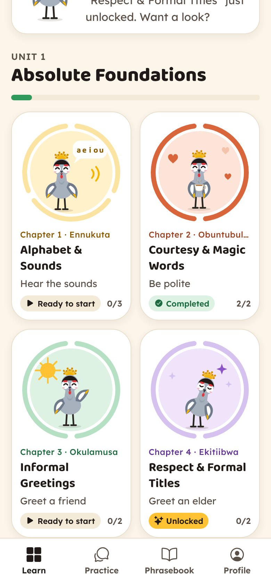
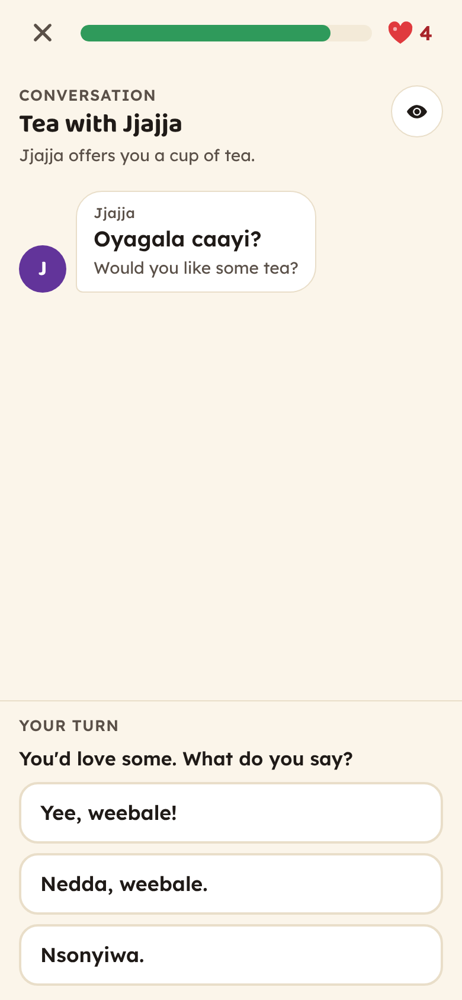
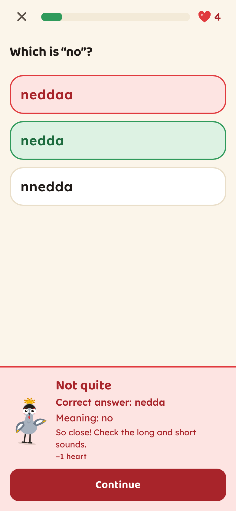
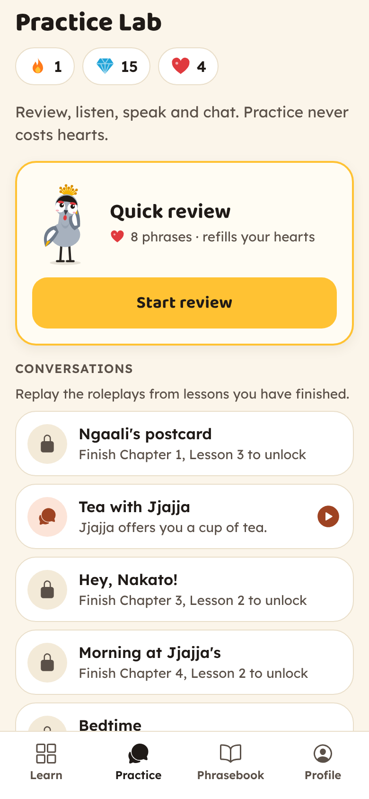
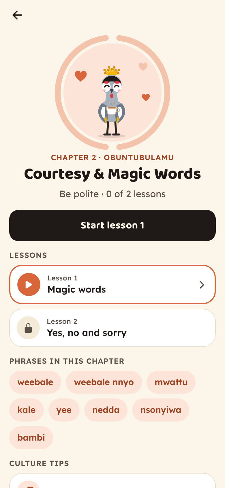
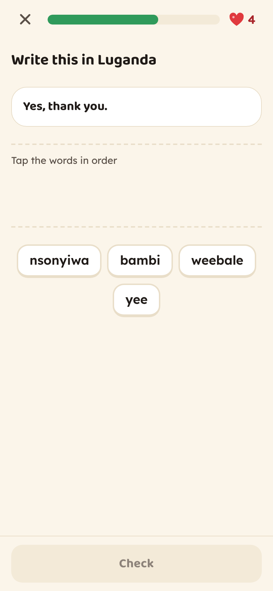
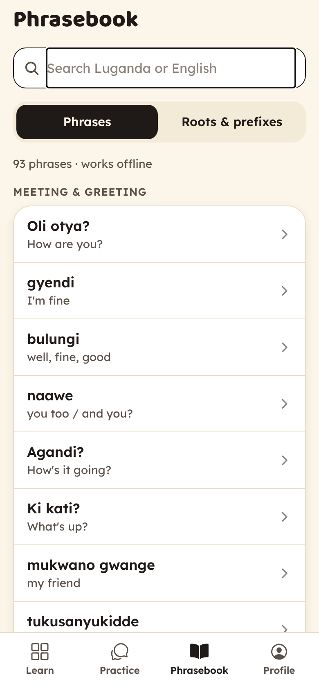
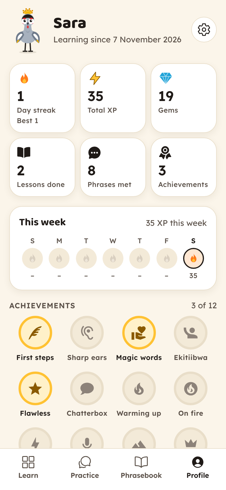

# Yiga Oluganda 🪶

**[English](#english) · [Svenska](#svenska)**

A mobile app for learning Luganda with **Ngaali**, the crested crane. It runs on iOS, Android and the web, built with Expo (React Native).
It is for absolute beginners, diaspora heritage learners, travellers and anyone curious about the language.

<p>




</p>
<p>




</p>

---

## English

### What's in the app

| PRD area | What was built |
|---|---|
| **Navigation** | Four tabs: **Learn** (home grid), **Practice** (Practice Lab), **Phrasebook** (dictionary) and **Profile** |
| **Home** | A stats bar with 🔥 streak, 💎 gems and ❤️ hearts, then Ngaali greeting you by name with a tip. Below that, Unit 1 as a 2-column grid of 12 chapter tiles. Each tile has its own Ngaali illustration (bowing to an elder, riding a boda-boda, holding a plate of matooke, …), a segmented progress ring with one segment per lesson, and a status: *Locked, Unlocked, Ready to start, Active, Unfinished* or *Completed* |
| **Non-linear unlocking** | Chapters 1–3 are open from the start, and each chapter you finish opens the next locked one, so you choose the order. The checkpoint (chapter 12) opens after chapters 1–11 |
| **Curriculum** | Unit 1, *Absolute Foundations*: the 12 chapters from the PRD, in 26 lessons. It has 93 phrases, 49 sentences, 12 roleplay conversations and 22 culture tips, all in English and Swedish |
| **Lesson engine** | Each lesson has about 10 steps built from the 7 PRD exercise types, plus a card that introduces each new phrase before it is tested. Wrong answers come back once at the end of the lesson |
| **Exercises** | **Sound & Vowel Matcher**: pick the right spelling. The wrong options differ only in sound length (*weebale / webale / weebbale*). **Tap & Match** pairs. **Word-bank sentence builder**. **Audio dictation**. **Speak & compare**. **Roleplay chat**: a wrong reply gets an explanation from Ngaali. **Culture tip** cards |
| **Ngaali's states** | *Idle* (bobs and blinks), *correct* (hops with wings up), *incorrect* (encouraging pose) and *badge* (holds a medal) |
| **Gamification** | +10 XP per lesson and +5 for a perfect one. Gems come from lessons. 5 hearts: a wrong answer in a lesson costs 1. Hearts grow back one every 20 minutes, and a Practice Lab review refills them all. There are daily streaks and 12 achievements |
| **Practice Lab** | Spaced-repetition review, which refills hearts. You can replay finished conversations. There is audio matching and Speak & compare. Practice never costs hearts |
| **Phrasebook** | Works offline. Search accepts *ng'* for ŋ and single letters for doubled ones. Phrases are grouped by everyday situation, and a **Roots & prefixes** guide covers *oku-*, *si-*, *n-/m-/ŋ-*, *tu-/mu-/ba-*, *w-/mw-* and *-ange* |
| **Profile** | Streak, XP, gems, lessons, phrases met, this week's activity, achievements and friends |
| **Languages** | The interface is in English or Swedish. You choose it at the start and can change it in Settings |

### Where the app differs from the PRD, and why

- **Audio.** No native-speaker recordings exist yet, and the app never uses text-to-speech for Luganda because it mispronounces the language. Listening, dictation and the native-speaker comparison appear **automatically** once recordings are added (see *Adding audio*). Until then, the Sound & Vowel Matcher shows the meaning instead of playing a sound.
- **Audio format.** The PRD asks for Opus. The app uses **AAC in .m4a**, because iOS cannot reliably play Opus or Ogg. The preparation script can also write Opus files. Slow "turtle" playback is the same clip played at 0.75× with pitch correction, so no separate slow recordings are needed. Clips are pre-loaded before each lesson starts.
- **Speech & pitch verification.** You record yourself and play your voice next to the native clip, then judge how close it was. There is no automatic scoring, because no reliable Luganda pronunciation model exists to run on a phone. The app says this on screen.
- **Friend leaderboards** need user accounts and a server, which this version doesn't have. The Profile explains this and shows your own weekly XP.
- **Unit downloads from a CDN.** Only Unit 1 exists, and it is bundled so it works offline.
- **What gems buy.** The PRD doesn't say, so 30 gems refill your hearts.
- **Content changes.** These were flagged for a native speaker in [`content/CONTENT_REPORT.md`](content/CONTENT_REPORT.md):
  - *Ki kano?* was taught as *Ki kati?*
  - *Mwe* was taught as *mmwe*.
  - *Yeye* was taught as *ye* (and *yeye* is accepted).
- **Mascot name.** The PRD uses both "Kigo" and "Ngaali". The app uses **Ngaali** throughout.

### Run it

You need [Node.js](https://nodejs.org) 20 or newer.

```bash
npm install
```

```bash
npx expo start
```

Scan the QR code with **Expo Go** on your phone, or press `w` to open it in a browser.

| Command | What it does |
|---|---|
| `npm test` | Unit tests: lesson engine, rules, content checks, colour contrast, translations |
| `npm run typecheck` | TypeScript check |
| `npm run doctor` | Checks Expo dependencies and config |
| `npm run audio` | Rebuilds the list of recordings and `AUDIO_TODO.md` |
| `npm run report` | Rebuilds `content/CONTENT_REPORT.md` |
| `npm run icons` / `npm run sfx` | Regenerate the app icons and sound effects |

End-to-end test in a real browser (mobile and desktop sizes):

```bash
EXPO_PUBLIC_E2E=1 npm run export:web && npm run e2e
```

### Build for the App Store and Google Play

Builds run in the cloud with EAS, so you don't need Xcode or Android Studio. You do need an Expo account, plus an Apple Developer and/or Google Play account.

```bash
npx eas-cli@latest build --platform all
```

The web version is a static site: `npm run export:web` writes it to `dist/`.

### Editing content

All content is plain JSON in [`content/unit-1/`](content/unit-1). `npm test` tells you exactly what's wrong if an id is missing or a translation is empty.

- `phrases.json`: each phrase has an `id` (also its audio file name), `lg` (Luganda), `tr` (`en` and `sv`), and optional `literal`, `note`, `variants` and `check` (a note for a native speaker).
- `sentences.json`: sentences for the word bank and dictation. `{name}` becomes the learner's name.
- `chapters.json`: chapters and their lessons. Each lesson lists its new `phrases`, plus `review`, `sentences`, `sounds`, `tip` and `dialogue`.
- `dialogues.json`: roleplay conversations. Each `choose` line needs exactly one `correct` option, and every wrong option needs a `why`.
- `tips.json`, `sound-pairs.json`, `roots.json`: culture tips, long/short sound pairs and the roots guide.

The app builds each lesson's exercises from these files automatically.

### Adding audio

1. Record each phrase with a native speaker and name the file after its id, e.g. `weebale.wav` or `s-kale-weebale.wav`. [`AUDIO_TODO.md`](AUDIO_TODO.md) lists every id that still needs a recording.
2. Run this to trim silence, normalise to −16 LUFS and save mono AAC clips into `assets/audio/` (needs `ffmpeg`):

   ```bash
   npm run audio:prepare -- path/to/recordings
   ```

3. Restart the app. Speaker buttons, listening, dictation and native comparison appear for every recorded item.

### Project layout

```
content/unit-1/     course content (JSON) + CONTENT_REPORT.md
assets/audio/       native-speaker clips (<id>.m4a)
src/app/            screens (Expo Router): tabs, chapter, lesson, practice, phrase, settings, onboarding
src/lesson/         lesson player, feedback panel, the exercise components
src/logic/          pure, unit-tested rules: generator, spelling distractors, hearts/XP/streak, unlocking, SRS, badges
src/state/          Zustand store, saved on the device (AsyncStorage)
src/ui/             Ngaali, chapter illustrations, progress ring, design tokens
src/i18n/           English and Swedish interface text
scripts/            audio, icons, sound effects, content report, e2e
```

### Privacy

There are no accounts, ads, analytics or tracking. Progress and recordings stay on the device. The fonts are bundled, so the app makes no requests to Google. You can erase everything in *Profile → Settings → Reset progress*.

The previous web version of the app, based on the book *Luganda för beginners* by Cyprine Kamoga, is in the git history at commit `6a7fad7`.

---

## Svenska

**Yiga Oluganda** är en app för att lära sig luganda tillsammans med kronstranen **Ngaali**. Den fungerar på iOS, Android och webben och är byggd med Expo (React Native). Gränssnittet finns på svenska och engelska.

**I appen:**
- En startsida med rutnät över del 1:s 12 kapitel och framstegsringar. Kapitlen öppnas i den ordning du själv väljer.
- Lektioner med cirka 10 steg av 7 övningstyper: ljud- och vokalmatchning, para ihop, bygga meningar, diktamen, prata och jämföra, rollspel och kulturtips.
- XP, ädelstenar, hjärtan, dagar i rad och prestationer.
- Ett övningslabb med repetition som fyller på hjärtan.
- En parlör som fungerar offline och har en guide till ordstammar och prefix.

**Starta appen** (Node.js 20 eller senare):

```bash
npm install
```

```bash
npx expo start
```

Skanna QR-koden med **Expo Go** eller tryck `w` för webbläsaren.

**Innehåll:** allt ligger som JSON i `content/unit-1/`. Kör `npm test` efter ändringar.

**Ljud:** spela in med en modersmålstalare, döp filerna efter id (se `AUDIO_TODO.md`) och kör:

```bash
npm run audio:prepare -- mapp/med/inspelningar
```

Appen använder aldrig datorröst för luganda.

**Viktigt:** lugandan i del 1 har inte granskats av en modersmålstalare än. Det som är mest osäkert listas i [`content/CONTENT_REPORT.md`](content/CONTENT_REPORT.md).

**Integritet:** inga konton, ingen reklam och ingen spårning. Allt sparas på enheten.
